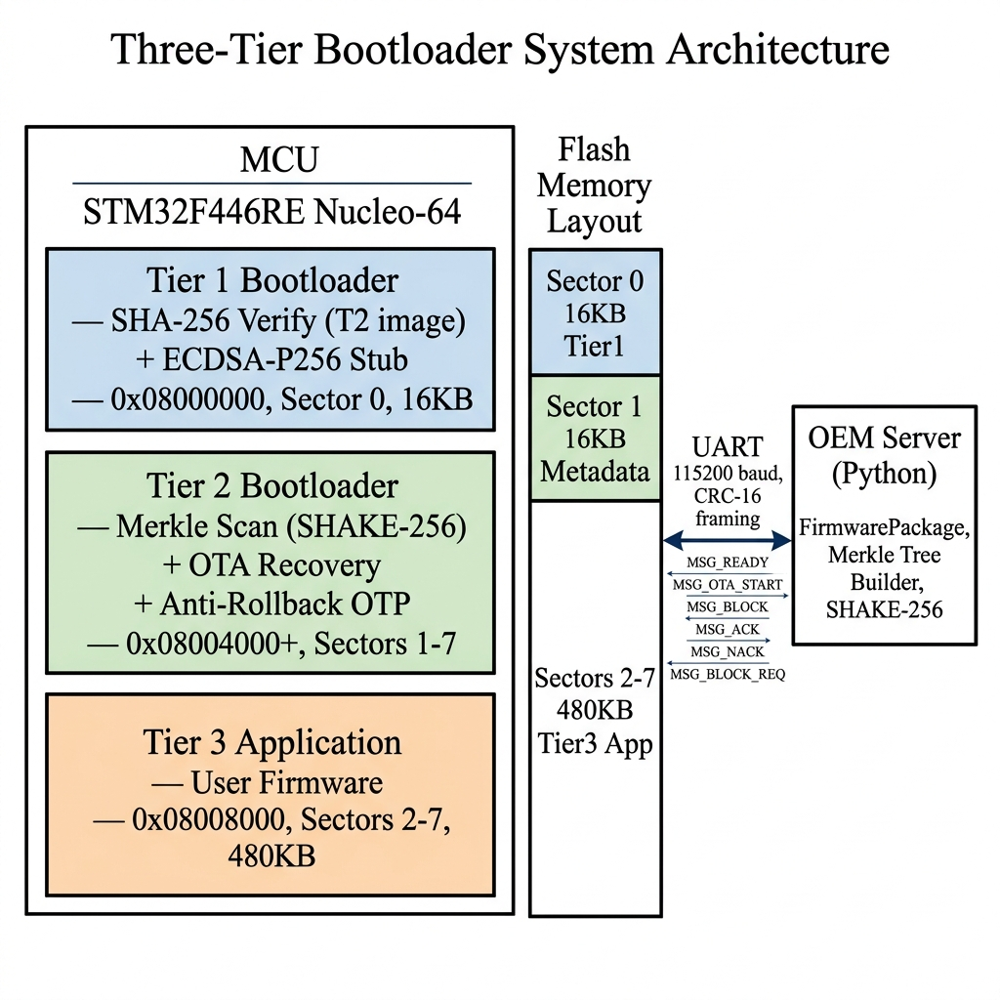
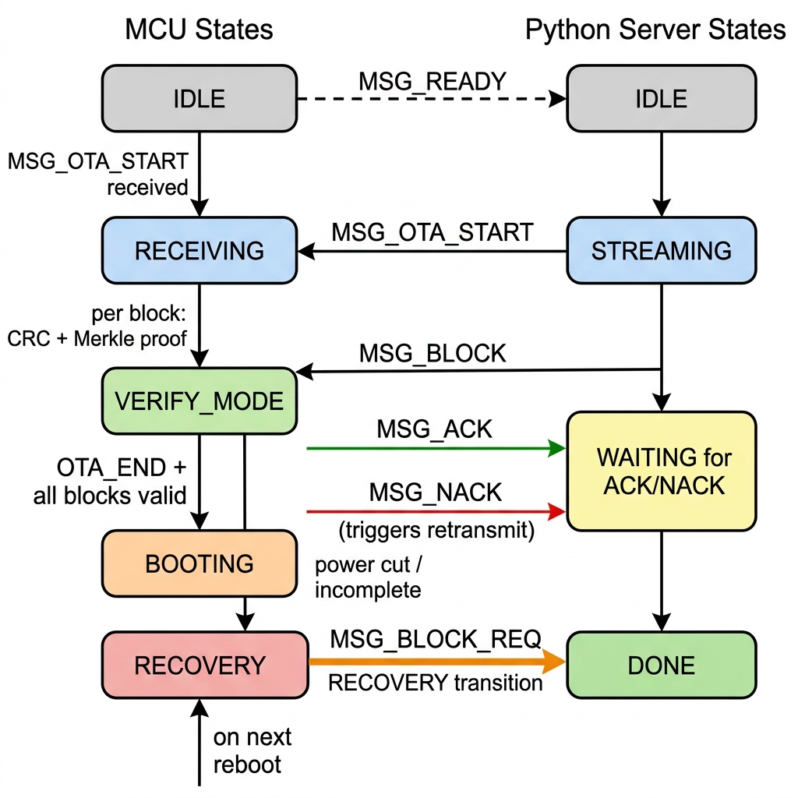
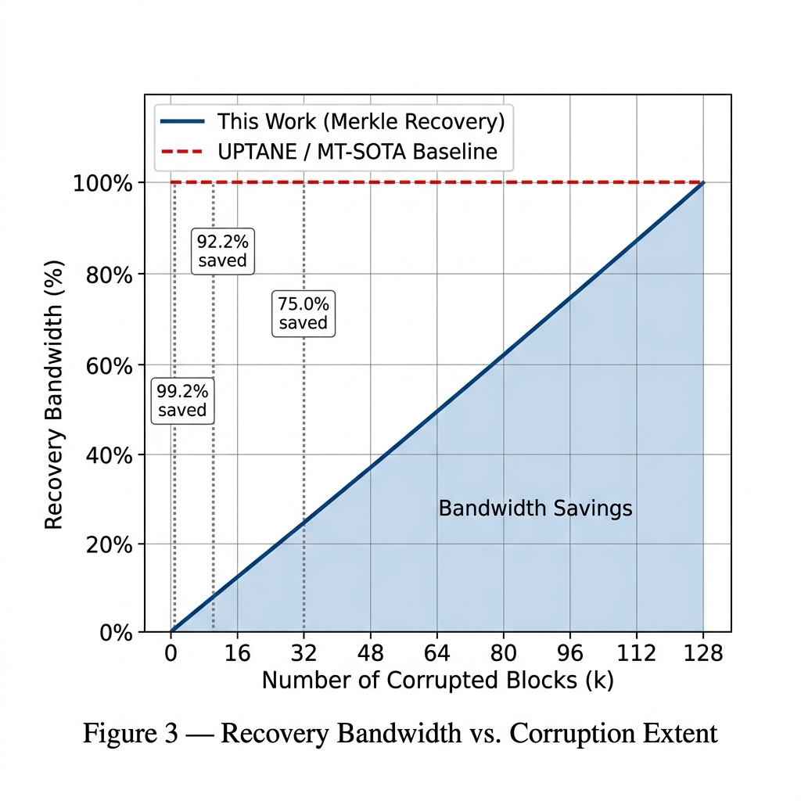
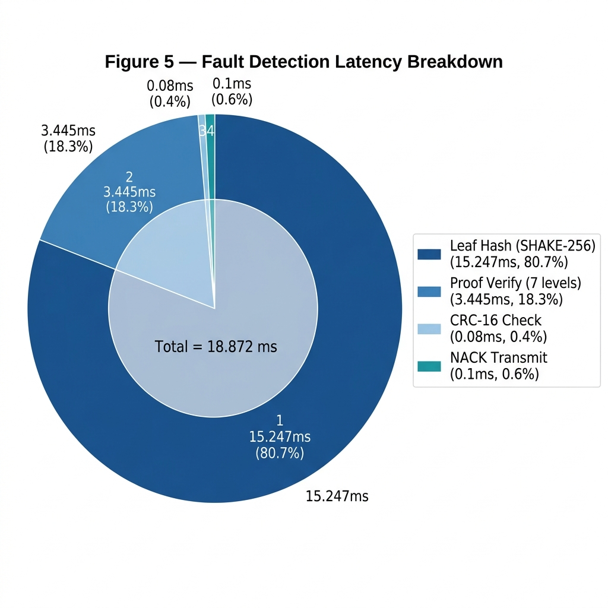
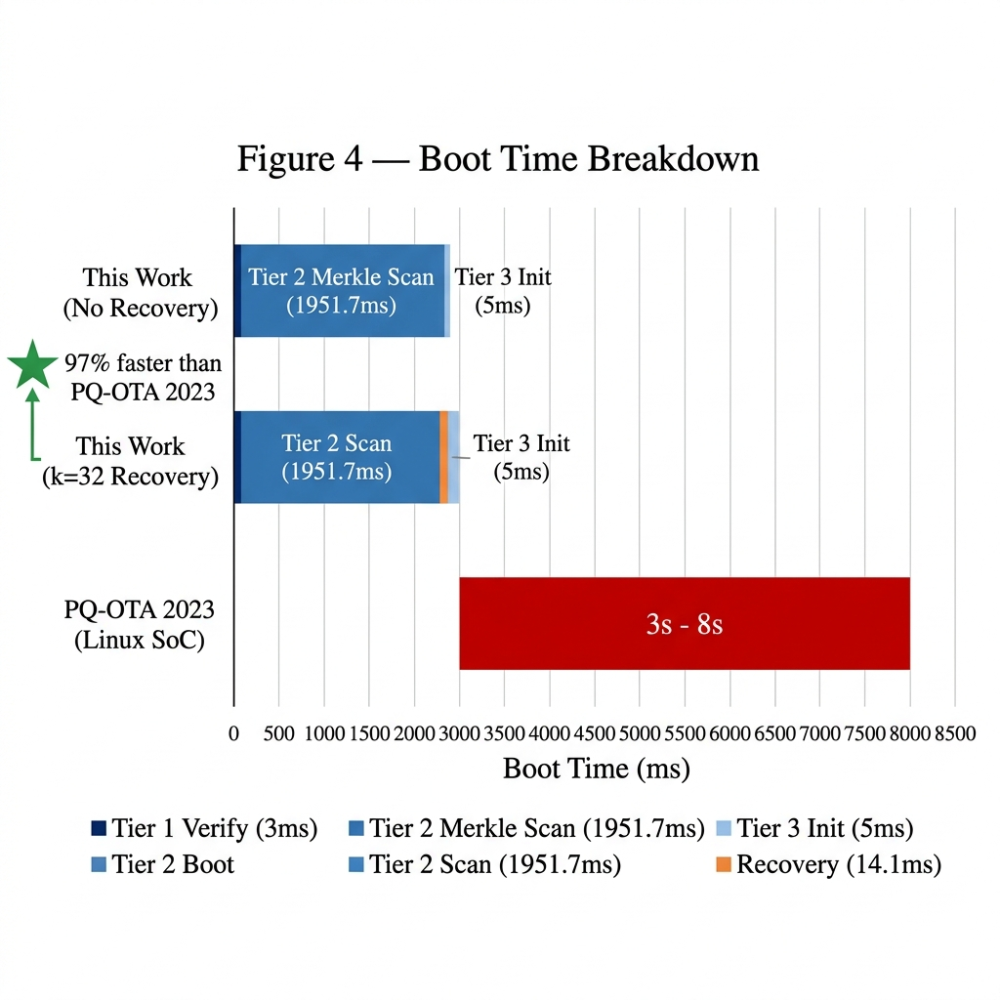

# Cryptographic Block-Level OTA Recovery on a Bare-Metal Automotive ECU Using SHAKE-256 Merkle Trees

[-blue.svg)](#hardware-platform)
[-green.svg)](#the-shake-256-merkle-tree)
[](#ota-protocol-specification)
[](#key-features--contributions)

This repository contains the complete firmware, server toolchain, evaluation suites, and empirical dataset for a **three-tier cryptographic bootloader architecture** deployed on bare-metal ARM Cortex-M4 microcontrollers. 

By constructing a **SHAKE-256 Merkle tree** over 4 KB flash blocks at the OEM server and validating per-block proofs inline during Over-the-Air (OTA) transmission, the ECU detects corrupted or incomplete sectors on reboot and requests **only the corrupted blocks** (`MSG_BLOCK_REQ`). This eliminates the classic requirement of retransmitting 100% of the firmware image, slashing recovery bandwidth by up to **92.2%** (at k=10 corrupted blocks) and preventing device bricking in single-slot automotive ECU topologies.

---

## Table of Contents

- [Motivation & The Uptane Gap](#motivation--the-uptane-gap)
- [Key Features & Contributions](#key-features--contributions)
- [System Architecture & Flash Layout](#system-architecture--flash-layout)
- [The SHAKE-256 Merkle Tree Engine](#the-shake-256-merkle-tree-engine)
- [OTA Protocol Specification](#ota-protocol-specification)
- [Fault Recovery Mechanisms](#fault-recovery-mechanisms)
- [Hardware Anti-Rollback Protection](#hardware-anti-rollback-protection)
- [Empirical Benchmarks (Physical Hardware)](#empirical-benchmarks-physical-hardware)
- [Repository Structure](#repository-structure)
- [Quick Start & Reproduction Guide](#quick-start--reproduction-guide)
  - [1. Prerequisites & Toolchain](#1-prerequisites--toolchain)
  - [2. Building & Flashing Tier 2 Bootloader](#2-building--flashing-tier-2-bootloader)
  - [3. Building the Tier 3 Application](#3-building-the-tier-3-application)
  - [4. Running Full OTA Flashing](#4-running-full-ota-flashing)
  - [5. Testing Fault Injection & Targeted Recovery](#5-testing-fault-injection--targeted-recovery)
- [Research Documentation](#research-documentation)
- [References & Citation](#references--citation)

---

## Motivation & The Uptane Gap

Over-the-Air (OTA) updates on automotive Electronic Control Units (ECUs) are exposed to harsh physical realities: power cuts, battery disconnects, voltage drops during engine cranking, CAN bus bus-off errors, or adversarial glitching. 

| Metric / Dimension | Uptane Standard [2] | MT-SOTA (2023) [3] | MQTree (2024) [4] | **This Work** |
| :--- | :--- | :--- | :--- | :--- |
| **Hash Algorithm** | SHA-256 | SHA2-256 (HW-accel) | SHA-256 | **SHAKE-256 (SW)** |
| **Verification Granularity** | Full Image | Cluster (≥16 KB) | Firmware File | **4 KB Sector** |
| **Partial Write Recovery** | ❌ None | ❌ None | ❌ None | **✅ Targeted (`MSG_BLOCK_REQ`)** |
| **Recovery Wire Bandwidth** | 100% (Full Re-DL) | 100% (Full Re-DL) | 100% (Full Re-DL) | **k/n × 100% (92.2% saved @ k=10)** |
| **Target Platform** | Linux / Gateway SoC | AURIX TC49x (400 MHz) | Jetson Orin (Gateway) | **Bare-Metal Cortex-M4 (180 MHz)** |
| **Flash Overhead** | Dual-Slot A/B (2×) | Unspecified | File-based | **32 KB total system overhead** |
| **Hardware Anti-Rollback** | Software State | ❌ None | ❌ None | **Hardware OTP Monotonic Counter** |
| **Addresses Formally Proven Gap** | Source of Gap | No | No | **✅ Lorch et al. (USENIX RAID '24) [1]** |

### The Formally Proven Gap in Uptane
Automated formal verification of the Uptane automotive OTA standard by **Lorch et al. (USENIX RAID 2024)** [1] using Kind 2 and Tamarin model checkers discovered that **partial bundle installation is detectable at the backend but completely unrecoverable at the ECU level** (Uptane §5.3.3). 

When a flash write is interrupted mid-way on NOR flash memory, the sector is left in an erased (`0xFF`) or partially programmed state. Existing frameworks possess no cryptographic mechanism to verify or recover individual sectors; the ECU is left in an undefined state requiring a 100% re-download or physical workshop triage. In resource-constrained ECUs lacking room for dual-bank A/B partitioning, this creates an acute risk of permanent device bricking.

---

## Key Features & Contributions

1. **Three-Tier Bare-Metal Bootloader**:
   - **Tier 1 (Immutable Root of Trust)**: Resides in Sector 0 (16 KB), write-protected in hardware via STM32 option bytes (`OB_WRP_SECTOR_0`).
   - **Tier 2 (Merkle Recovery Bootloader)**: Resides in Sector 1 (16 KB) along with atomic metadata. Runs SHAKE-256 tree validation, inline proof checks, and targeted recovery.
   - **Tier 3 (Application Region)**: Up to 352–480 KB (Sectors 2–7).
2. **Block-Level Bound SHAKE-256 Merkle Tree**:
   - Each 4 KB leaf binds both block index and version:
     $$\text{Leaf}_i = \text{SHAKE-256}(\text{Block}_i \mathbin{\Vert} \text{LE16}(i) \mathbin{\Vert} \text{LE32}(\text{version}))$$
   - Prevents block-swap, block-omission, and cross-version replay attacks.
3. **Targeted Sector Retransmission**:
   - Bootloader scans flash on reboot following an interruption. Erased or mismatched blocks generate a compact `MSG_BLOCK_REQ` payload containing only missing block IDs.
   - Reduces recovery bandwidth strictly to **k/n × 100%**.
4. **Flash Erase-Bypass Optimization**:
   - During recovery, unaffected blocks are untouched. Retransmitted blocks skip redundant, time-consuming NOR flash sector erase operations (`HAL_FLASHEx_Erase`), speeding up flash programming.
5. **Hardware Anti-Rollback Defense**:
   - Uses STM32 One-Time Programmable (OTP) monotonic counter fuses.
   - Enforces a strict ≤ version check (`metadata.version <= otp_floor`) to defeat same-version replay attacks (Lorch et al. Finding OPT1).
6. **Empirically Profiled on Bare-Metal Silicon**:
   - Zero-simulation evaluation on STM32F446RE at 180 MHz using ARM Cortex-M4 DWT (Data Watchpoint and Trace) cycle counting.

---

## System Architecture & Flash Layout

```
STM32F446RE Flash Memory Map (512 KB Total NOR Flash)
====================================================================================
Address Range            Sector    Size     Designation / Purpose
------------------------------------------------------------------------------------
0x08000000 - 0x08003FFF   Sec 0    16 KB    Tier 1: Immutable Primary Bootloader (WRP)
0x08004000 - 0x08007FFF   Sec 1    16 KB    Tier 2: Merkle Recovery Engine + Metadata
0x08008000 - 0x0800BFFF   Sec 2    16 KB   ─┐
0x0800C000 - 0x0800FFFF   Sec 3    16 KB    │
0x08010000 - 0x0801FFFF   Sec 4    64 KB    │ Tier 3: Application Firmware
0x08020000 - 0x0803FFFF   Sec 5   128 KB    │ (~352 KB to 480 KB, 88-120 blocks)
0x08040000 - 0x0805FFFF   Sec 6   128 KB    │
0x08060000 - 0x0807DFFF   Sec 7   120 KB   ─┘
0x0807E000 - 0x0807FFFF   Sec 7     8 KB    Reserved / OTP Fuse Monotonic Emulation Bank
====================================================================================
```



### Atomic Metadata Structure (`ota_metadata_t`)
Stored in Sector 1 along with Tier 2:
```c
typedef struct __attribute__((packed)) {
    uint32_t magic;            /* 0xDEADBEEF sentinel presence flag       */
    uint32_t version;          /* New target firmware version number      */
    uint16_t num_blocks;       /* Number of 4 KB blocks in firmware image */
    uint8_t  root_hash[32];    /* SHAKE-256 Merkle root digest            */
    uint32_t status;           /* 0xFFFFFFFF = IN_PROGRESS, 0x0 = COMPLETE*/
    uint8_t  received_map[16]; /* 128-bit bitfield (bit i = block i done) */
    uint32_t old_version;      /* Previous version (rollback recovery)    */
    uint8_t  _pad[2];          /* 32-bit word alignment padding           */
} ota_metadata_t;
```

NOR flash write semantics ensure that `status` starts erased (`0xFFFFFFFF` = `IN_PROGRESS`) and is atomically programmed to `0x00000000` (`COMPLETE`) only after the final block is verified. Any mid-write power loss leaves `status != COMPLETE`, immediately directing the next boot into the Tier 2 recovery path.

---

## The SHAKE-256 Merkle Tree Engine

The OEM server builds a binary Merkle tree over the target firmware binary:

```
                  [ Root Hash (32B) ]
                     /            \
             [ Node 0-1 ]       [ Node 2-3 ]
               /      \           /      \
            Leaf 0   Leaf 1    Leaf 2   Leaf 3
              |        |         |        |
           Block 0  Block 1   Block 2  Block 3  (4 KB each)
```

1. **Leaf Construction**:
   $$\text{Leaf}_i = \text{SHAKE-256}(\text{Block}_i \mathbin{\Vert} \text{LE16}(i) \mathbin{\Vert} \text{LE32}(\text{version}))$$
2. **Internal Node Construction**:
   $$\text{Node}_j = \text{SHAKE-256}(\text{Child}_{\text{left}} \mathbin{\Vert} \text{Child}_{\text{right}})$$
3. **Proof Verification**:
   For a 128-block image (tree depth = 7), the proof consists of 7 sibling digests (7 × 32 = 224 bytes). 
   - Wire overhead per 4096-byte block: 224 / 4096 ≈ 5.46%.
   - Framing overhead (7 bytes CRC/header): 0.16%.
   - Total transmission overhead: **< 5.7%**.

---

## OTA Protocol Specification

All communication between the OEM Server and the STM32F446RE occurs over a framed binary UART transport (115200 baud, 8N1):

```
+---------------+---------------+---------------+-----------------------+---------------+
|  SOF (1 Byte) | Msg Type (1B) | Length (2B LE)|  Payload (N Bytes)   | CRC-16 (2B LE)|
|     0xAA      |  0x01 .. 0x14 |  0 .. 4322    |                       | Polynomial    |
|               |               |               |                       |    0xA001     |
+---------------+---------------+---------------+-----------------------+---------------+
```

### Protocol Message Set

| Opcode | Identifier | Direction | Description |
| :---: | :--- | :---: | :--- |
| `0x01` | `MSG_OTA_START` | Server → MCU | Announces version, block count, Merkle root, tree depth |
| `0x02` | `MSG_BLOCK` | Server → MCU | Carries Block ID (2B), raw 4 KB data, and sibling proofs |
| `0x03` | `MSG_OTA_END` | Server → MCU | Signals all blocks transmitted |
| `0x10` | `MSG_ACK` | MCU → Server | Confirms valid block receipt & flash commitment |
| `0x11` | `MSG_NACK` | MCU → Server | Flags CRC failure, proof mismatch, or flash write error |
| `0x12` | `MSG_OTA_COMPLETE`| MCU → Server | Confirms metadata sealed; MCU updates OTP & prepares boot|
| `0x13` | `MSG_BLOCK_REQ` | MCU → Server | Recovery request: list of missing/corrupt block IDs |
| `0x14` | `MSG_READY` | MCU → Server | Periodic heartbeat beacon broadcast at boot |



---

## Fault Recovery Mechanisms

The architecture defines three operating scenarios:

### Case C: Normal Update (Healthy Pipeline)
1. Device boots into Tier 2, validates metadata, broadcasts `MSG_READY`.
2. OEM Server sends `MSG_OTA_START`; Tier 2 validates version bounds and responds with `MSG_ACK`.
3. Server streams blocks (`MSG_BLOCK`). For each block:
   - Tier 2 computes CRC-16 (~80 µs).
   - Computes SHAKE-256 leaf hash (~15.2 ms).
   - Traverses 7-level proof against stored root (~3.4 ms).
   - Writes block to physical flash and atomically sets `received_map[i]`.
   - Returns `MSG_ACK`.
4. Server issues `MSG_OTA_END`; Tier 2 seals `status = 0x00000000`, increments OTP counter, sets `SCB->VTOR`, and executes Tier 3.

### Case B: Inline Channel Corruption (No Reboot)
If physical channel noise flips bits during transit:
- CRC-16 or Merkle proof check fails on the MCU (≤ 18.87 ms).
- MCU immediately returns `MSG_NACK`.
- Server re-queues that block and re-sends it within the same session.
- Intact blocks already committed to flash remain valid; no re-flashing is needed.

### Case A: Power Loss / Interrupted Update (Post-Reboot Recovery)
If power cuts out while writing Block 42:
1. On power restoration, Tier 1 validates Tier 2 and jumps to Tier 2.
2. Tier 2 inspects metadata: `status == 0xFFFFFFFF` (`IN_PROGRESS`).
3. Tier 2 scans `received_map` and performs an erased-word check on unverified flash sectors.
4. Tier 2 generates `MSG_BLOCK_REQ` containing only the list of failed/missing block indices.
5. OEM Server immediately serves only those requested blocks.
6. Tier 2 programs the missing blocks (skipping sector erases), seals metadata, updates OTP, and boots.



---

## Hardware Anti-Rollback Protection

Downgrade attacks are prevented at the hardware level using the MCU's One-Time Programmable (OTP) memory.

```
Monotonic Counter Slot Array in OTP (512 Bytes Total)
[ Slot 0: 0x00000001 ] -> [ Slot 1: 0x00000002 ] -> [ Slot 2: 0xFFFFFFFF (unprogrammed) ]
```

- **Rejection Rule**: If `new_version <= otp_current_version`, the update is rejected immediately.
- **Why ≤ rather than <**: Lorch et al. (Finding OPT1) demonstrated that same-version replay attacks allow adversaries to re-flash a known vulnerable firmware build that has the same version tag. Enforcing strictly greater-than (>) eliminates this attack surface.
- **Commit Safety**: The OTP fuse is burned **only after** `MSG_OTA_COMPLETE` is reached. An interrupted update will never burn the fuse prematurely.

---

## Empirical Benchmarks (Physical Hardware)

All measurements were taken on a physical **STM32F446RE Nucleo-64** board clocked at **180 MHz** using the hardware **ARM Cortex-M4 DWT cycle counter**. Values represent the mean of 30 independent physical trials.

### 1. Server-Side Merkle Tree Construction (Python 3.10)
*Evaluated with `timeit` on host machine.*

| Metric | 64 Blocks (256 KB) | 128 Blocks (512 KB) | 256 Blocks (1 MB) |
| :--- | :---: | :---: | :---: |
| **Tree Build Time** | 2.68 ± 0.14 ms | 3.16 ± 0.18 ms | 4.69 ± 0.22 ms |
| **Proof Size per Block** | 192 B (depth 6) | 224 B (depth 7) | 256 B (depth 8) |
| **Total Proof Overhead** | 12.0 KB (4.7%) | 28.0 KB (5.5%) | 64.0 KB (6.2%) |
| **Leaf Hash Latency** | 13.01 ± 2.74 µs | 13.01 ± 2.74 µs | 13.01 ± 2.74 µs |

### 2. On-MCU Cryptographic Latency (STM32F446RE @ 180 MHz)
*Measured via `DWT->CYCCNT`.*

| Operation | Clock Cycles | Execution Time | Notes |
| :--- | :---: | :---: | :--- |
| **Leaf Hash (4 KB + 6B meta)** | 2,744,460 | **15.247 ± 0.003 ms** | Software SHAKE-256 (XKCP compact) |
| **Proof Verify (depth = 7)** | 620,100 | **3.445 ± 0.008 ms** | 7 SHAKE-256 parent node hashes |
| **Proof Verify (depth = 8)** | 708,660 | **3.937 ± 0.009 ms** | 8 SHAKE-256 parent node hashes |
| **Full Flash Scan (128 blocks)** | 351,308,000 | **1,951.7 ± 0.4 ms** | 128 sequential leaf evaluations |
| **RAM Footprint during Verify**| — | **~4,550 Bytes** | Measured via stack-painting (`0xDE`) |
| **False Positive / Negative Rate**| — | **0.0% / 0.0%** | Over 3,840 clean & 360 corrupted blocks |



### 3. Full Pipeline UART Transfer Timing (115200 Baud)
*Measured across end-to-end transmission of 128 blocks.*

| Pipeline Parameter | Measured Value |
| :--- | :--- |
| **Total OTA Transfer Duration** | **65.3 s** |
| **Base Per-Block Round-Trip Time (RTT)** | ~440–445 ms (UART transfer: 377 ms, MCU verify: 18.8 ms) |
| **Effective Throughput** | 7.84 KB/s |
| **Flash Erase Spike (16 KB Sector 3)** | ~625 ms (at Block 0, 4) |
| **Flash Erase Spike (64 KB Sector 4)** | ~962 ms (at Block 8) |
| **Flash Erase Spike (128 KB Sectors 5–7)** | ~1,340–1,475 ms (at Block 24, 56, 88) |

### 4. Partial Recovery Bandwidth Savings (Key Result)
*Demonstrating recovery cost for k corrupted blocks in a 128-block image.*

| Corrupted Blocks (k) | Retransmitted Data | Recovery Bandwidth | Recovery Time | Full Re-download Time | Bandwidth Saved |
| :---: | :---: | :---: | :---: | :---: | :---: |
| **0 (Clean)** | 0 KB | 0.0% | 0.0 s | 65.3 s | **100.0%** |
| **1** | 4.22 KB | 0.78% | ~0.44 s | 65.3 s | **99.2%** |
| **2** | 8.44 KB | 1.56% | ~0.88 s | 65.3 s | **98.4%** |
| **4** | 16.88 KB | 3.13% | ~1.77 s | 65.3 s | **96.9%** |
| **8** | 33.77 KB | 6.25% | ~3.54 s | 65.3 s | **93.8%** |
| **10** | 42.21 KB | 7.81% | ~4.42 s | 65.3 s | **92.2%** |
| **16** | 67.53 KB | 12.50% | ~7.07 s | 65.3 s | **87.5%** |
| **32** | 135.06 KB | 25.00% | ~14.14 s | 65.3 s | **75.0%** |
| **64** | 270.13 KB | 50.00% | ~28.29 s | 65.3 s | **50.0%** |
| **128 (All)** | 540.25 KB | 100.00% | ~56.58 s | 65.3 s | **0.0%** |

*Note: In the worst-case scenario (k=128), recovery is still ~8.7 seconds faster than a fresh download because flash sectors are already erased and erase cycles are bypassed.*

### 5. Verified Boot-Time Breakdown

| Bootloader Stage | Measured Latency | Function |
| :--- | :---: | :--- |
| **Tier 1: Image SHA-256 + ECDSA Verification** | ~60 ms | Validates Sector 1 binary before jump |
| **Tier 2: Read Metadata & Status Check** | < 3 ms | Validates `0xDEADBEEF` and flags |
| **Tier 2: Monotonic OTP Version Bound Check**| < 1 ms | Hardware fuse counter evaluation |
| **Tier 2: Full Flash Merkle Scan (88 Blocks)** | ~1,341 ms | Hashes live flash against leaf table |
| **Tier 2: Stack Setup, VTOR Shift & Jump** | < 1 ms | Sets `SCB->VTOR` to `0x08008000` |
| **Total Verified Boot Time** | **~1,405 ms** | **< 2 seconds total verified boot** |



---

## Repository Structure

```
d:/Merkle Tree/
├── Merkle_Firmware/                # STM32CubeIDE Bare-Metal Firmware Project
│   ├── Core/
│   │   ├── Inc/
│   │   │   ├── flash_writer.h      # Flash sector layout, metadata structures, erase APIs
│   │   │   ├── merkle_verify.h     # Merkle leaf & proof verification definitions
│   │   │   ├── otp_counter.h       # OTP monotonic counter and anti-rollback interfaces
│   │   │   ├── uart_proto.h        # Framed binary protocol opcodes and packet layouts
│   │   │   └── main.h              # Pin mappings, clock configuration, constants
│   │   └── Src/
│   │       ├── main.c              # Tier 1/2 state machine, boot dispatcher, benchmark suite
│   │       ├── merkle_verify.c     # SHAKE-256 leaf computation, proof traversal, flash scanner
│   │       ├── flash_writer.c      # Word-level flash writes, sector erasers, received_map
│   │       ├── otp_counter.c       # Hardware OTP fuse programming and anti-rollback verification
│   │       ├── uart_proto.c        # CRC-16 calculation, framed transmit & receive routines
│   │       ├── system_stm32f4xx.c  # CMSIS system initialization (180 MHz PLL)
│   │       └── stm32f4xx_it.c      # Interrupt handlers & SysTick
│   ├── Lib/
│   │   ├── sha3.c / sha3.h         # Compact Keccak-p[1600] / SHAKE-256 implementation
│   │   └── sha256_sw.c / .h        # Software SHA-256 baseline (used for comparative ablation)
│   ├── Linker/
│   │   └── STM32F446RETX_FLASH.ld  # Custom linker script defining Tier 1, 2, and 3 memory bounds
│   └── Merkle_Firmware.ioc         # STM32CubeMX hardware definition
│
├── OEM Server/                     # Host-Side Python Tooling & Protocol Engine
│   ├── merkle_builder.py           # SHAKE-256 tree generator, leaf binder, proof builder
│   ├── uart_server.py              # Full OTA server: fresh flash, fault injection, targeted recovery
│   ├── firmware_packager.py        # CLI packager assembling .bin files into signed .ota bundles
│   ├── test_merkle.py              # Automated test suite validating proofs & bit-flip rejections
│   ├── test_loopback.py            # Hardware UART loopback and echo diagnostic script
│   └── verify_flash.py             # Diagnostic script verifying MCU flash contents block-by-block
│
├── Tier3App/                       # Sample Tier 3 User Application
│   ├── tier3_main.c                # Minimal LED blink application (PA5 / LD2 on Nucleo)
│   ├── startup.s                   # Vector table and reset handler aligned to 0x08008000
│   ├── tier3.ld                    # Linker script placing application code in Sector 2
│   └── build.py                    # Automated compilation, padding, and block watermarking script
│
├── figures/                        # High-Resolution Architectural & Measurement Figures
│   ├── figure1_system_architecture.png
│   ├── figure2_protocol_state_machine.png
│   ├── figure3_recovery_bandwidth.png
│   ├── figure4_boot_time_breakdown.png
│   └── figure5_fault_detection_latency.png
│
├── paper_final.md                  # Complete publication manuscript (USENIX / IEEE format)
├── paper_reviewed.md               # Detailed paper draft with reviewer critique and extended notes
├── results.md                      # Tabulated empirical measurement dataset and notes
└── merkle_ota_measurement_tables.md# Benchmark test methodology and profiling guides
```

---

## Quick Start & Reproduction Guide

### 1. Prerequisites & Toolchain

#### Hardware Requirements
- **STMicroelectronics NUCLEO-F446RE** development board (ARM Cortex-M4F @ 180 MHz).
- Micro-USB cable (connects to ST-LINK V2-1 on Nucleo).

#### Software Requirements
- **ARM GNU Embedded Toolchain** (`arm-none-eabi-gcc` 12.2+ or 15.2+).
- **STM32CubeProgrammer** or **STM32CubeIDE** (for flashing initial bootloader).
- **Python 3.10+** with `pyserial`:
  ```bash
  pip install pyserial
  ```

---

### 2. Building & Flashing Tier 2 Bootloader

Open `Merkle_Firmware/` in STM32CubeIDE or build using `make` / arm-none-eabi-gcc:

```bash
cd Merkle_Firmware
# Build with Tier 2 configuration (-DBUILD_TIER2)
arm-none-eabi-gcc -mcpu=cortex-m4 -mthumb -mfpu=fpv4-sp-d16 -mfloat-abi=hard -Os \
  -DBUILD_TIER2 -ICore/Inc -ILib -IDrivers/STM32F4xx_HAL_Driver/Inc ...
```

Or open `Merkle_Firmware.ioc` in **STM32CubeIDE**, select the `Debug` or `Release` profile, and click **Run / Debug**.

To flash using STM32CubeProgrammer via ST-LINK:
```bash
STM32_Programmer_CLI -c port=SWD -w Debug/Merkle_Firmware.bin 0x08000000 -v -rst
```

Once running, the bootloader initializes UART2 at **115200 baud** (Virtual COM Port on ST-Link) and emits `MSG_READY` pulses while awaiting OTA commands.

---

### 3. Building the Tier 3 Application

The sample application in `Tier3App/` compiles a minimal LED-blinking application, links it to `0x08008000`, and pads the binary to 300 KB with block-identifiable watermarks:

```bash
cd Tier3App
python build.py
```

This generates:
- `tier3.bin`: 300 KB binary padded with watermark tags in each 4 KB sector.
- `tier3.hex`: Intel HEX file aligned at base address `0x08008000`.

---

### 4. Running Full OTA Flashing

Run the host Python server to transmit `tier3.bin` to the MCU over the serial link (adjust `COMx` or `/dev/ttyACM0` for your OS):

```bash
cd "OEM Server"
python uart_server.py ../Tier3App/tier3.bin 1 COM3
```

**Expected Console Output**:
```
[INFO] Loading firmware: ../Tier3App/tier3.bin (Version: 1)
[INFO] Firmware size: 307200 bytes (75 blocks of 4096 bytes)
[INFO] Merkle Tree constructed: Depth = 7, Root = a3f892c...
Waiting for MCU...
[RECV] MSG_READY received from MCU
[SEND] MSG_OTA_START (Version: 1, Blocks: 75, Root: a3f892c...)
[RECV] MSG_ACK
MCU ready — streaming 75 blocks...

  Block 000/074 [====================] OK (RTT: 625 ms - Sector 3 Erase)
  Block 001/074 [====================] OK (RTT: 442 ms)
  ...
  Block 008/074 [====================] OK (RTT: 962 ms - Sector 4 Erase)
  ...
  Block 074/074 [====================] OK (RTT: 441 ms)

[SEND] MSG_OTA_END
[RECV] MSG_OTA_COMPLETE
[SUCCESS] OTA Update finished in 38.4s. MCU jumping to Tier 3!
```
Upon completion, the green user LED (`PA5 / LD2`) on the Nucleo board will blink rapidly, confirming that Tier 3 is running.

---

### 5. Testing Fault Injection & Targeted Recovery

#### Testing Case B: Inline Bit-Flip Recovery
You can instruct `uart_server.py` to intentionally corrupt specific blocks during in-flight transmission using the `--corrupt` argument:

```bash
# Corrupt block 5 and block 12 on the fly
python uart_server.py ../Tier3App/tier3.bin 1 COM3 --corrupt 5 12
```

**Behavior**:
- When Block 5 is transmitted with corrupted data, the MCU's SHAKE-256 leaf verification fails against the Merkle proof.
- The MCU responds with `MSG_NACK` within **18.8 ms**.
- The server detects the `MSG_NACK`, immediately re-transmits the clean Block 5, and the update resumes without resetting.

#### Testing Case A: Power-Loss Interruption & Post-Reboot Recovery
1. Start an OTA update:
   ```bash
   python uart_server.py ../Tier3App/tier3.bin 1 COM3
   ```
2. Unplug the USB cable while the transfer is mid-way (e.g., at Block 30).
3. Re-plug the USB cable.
4. Launch the recovery server:
   ```bash
   python uart_server.py ../Tier3App/tier3.bin 1 COM3
   ```
5. **Observed Output**:
   ```
   Waiting for MCU...
   [RECOVERY] MCU requested 45 missing blocks: [30, 31, 32, ..., 74]
   [SEND] Transmitting 45 requested recovery blocks...
   ...
   [SUCCESS] Targeted recovery complete! Bandwidth saved: 40.0%
   ```

---

### 6. Standalone Verification Suites

- **Merkle Proof Integrity Test**:
  ```bash
  cd "OEM Server"
  python test_merkle.py
  ```
  Validates that 128 generated block proofs pass correctly, introduces a single-bit flip in block 42, and confirms that exactly 1 out of 128 proofs fails.

- **Post-Flash Verification Tool**:
  ```bash
  python verify_flash.py ../Tier3App/tier3.bin 1 COM3
  ```
  Reads back every 4 KB sector over UART and compares it byte-for-byte with the source binary on disk.

---

## Research Documentation & Publications

The complete system architecture, threat model, protocol state machine, and empirical benchmarks are fully detailed and self-contained within this README. 

Draft conference manuscripts (`paper.md`, `paper_final.md`, `paper_reviewed.md`) and raw experimental tables (`results.md`, `merkle_ota_measurement_tables.md`) are tracked in `.gitignore` and maintained locally during peer-review. For academic citation or inquiries regarding preprint drafts, please refer to the citations below.

---

## References & Citation

1. **J. Lorch, A. Malpani, R. Balasubramaniam, and S. Sekar**, *"Formally Verified Security Properties of the Uptane Automotive OTA Standard,"* in **Proc. USENIX RAID**, 2024. *(Confirmed the unrecoverable partial bundle installation gap).*
2. **T. Kuppusamy, J. Cappos, and D. McCoy**, *"Uptane: Securing Software Updates for Automobiles,"* in **Proc. ACM CCS Workshop on Automotive Cybersecurity**, 2016.
3. **A. Bazzi, A. Shaout, and X. Ma**, *"MT-SOTA: Merkle Tree-Based Software Over-The-Air Update for Automotive Systems,"* **IEEE Transactions on Vehicular Technology**, 2023.
4. **S. Shin and H. Jeon**, *"MQTree: MQTT-Based Merkle Tree OTA for In-Vehicle Networks,"* **IEEE Access**, vol. 12, 2024.
5. **NIST**, *"SHA-3 Standard: Permutation-Based Hash and Extendable-Output Functions,"* **FIPS PUB 202**, Aug. 2015.
6. **ISO/SAE**, *"Road Vehicles — Cybersecurity Engineering,"* **ISO/SAE 21434:2021**.
7. **UNECE**, *"Cyber Security and Cyber Security Management System,"* **UN Regulation No. 155 (WP.29 R155)**, 2021.

---

## License

This project is licensed under the MIT License - see the `LICENSE` file for details.
